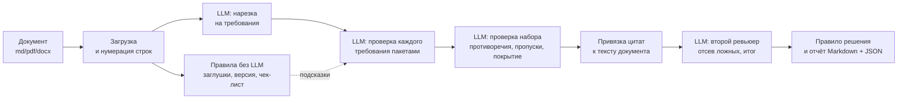

# RequirementLab — агент проверки требований

AI-агент для **BCC-HUB × MNU FinTech Hackathon 2026** ([кейс](https://github.com/BCC-HUB/ai-requirements-validator-task)).
Агент проводит статическое ревью документа требований до начала разработки. Он нарезает документ на отдельные требования,
проверяет каждое требование и весь набор по ISO/IEC/IEEE 29148:2018 (п. 5.2.5, 5.2.6) и IEEE Std 830-1998 (п. 4.3),
а затем пишет отчёт на русском языке. Каждое замечание привязано к дословной цитате и номеру строки документа.

## Быстрый старт

Нужен Python 3.10 или новее.

```bash
git clone <этот репозиторий> && cd requirementlab
python -m pip install -r requirements.txt
cp .env.example .env          # Windows: copy .env.example .env
# впишите GEMINI_API_KEY в .env
```

Документ кейса скачивается из репозитория организаторов:

```bash
curl -L -o docs/requirements.md https://raw.githubusercontent.com/BCC-HUB/ai-requirements-validator-task/main/docs/requirements.md
```

**Прогон одной командой**: первый аргумент — путь к документу, второй — путь к отчёту.

```bash
python run.py docs/requirements.md reports/report.md
```

Отчёт ляжет в `reports/report.md`, а рядом в `reports/report.json` — те же данные в структурированном виде.
На входе поддерживаются `.md`, `.txt`, `.pdf` (с текстовым слоем) и `.docx`.

## Как получить ключ LLM

По умолчанию агент работает на **Google Gemini `gemini-2.5-flash`**. Бесплатного тарифа хватает.

1. Откройте [aistudio.google.com/apikey](https://aistudio.google.com/apikey) и войдите через Google-аккаунт.
2. Нажмите **Create API key** и скопируйте ключ.
3. Вставьте его в файл `.env` в корне проекта: `GEMINI_API_KEY=...`

Ключ хранится только в `.env`, а этот файл исключён из Git. В репозитории лежит только `.env.example` без ключа.

Другая модель задаётся в `.env` (`GEMINI_MODEL=...`) или флагом `--model`. Можно взять и любой OpenAI-совместимый
API (OpenAI, Groq, OpenRouter, локальная Ollama): примеры есть в `.env.example`.

```bash
python run.py docs/requirements.md reports/report.md --provider openai --model gpt-4o-mini
```

| Флаг | Назначение |
| :--- | :--- |
| `--provider gemini\|openai` | провайдер LLM (по умолчанию — по ключу в `.env`) |
| `--model NAME` | модель |
| `--batch-size N` | сколько требований проверять за один запрос (по умолчанию 6) |
| `--no-verify` | пропустить шаг второго ревьюера |
| `--no-cache` | не брать ответы модели из кэша `.cache/llm` |
| `--quiet` | не печатать ход прогона |

## Как работает агент



| Шаг | Что происходит | Почему так |
| :--- | :--- | :--- |
| Загрузка | Текст разбивается на строки с номерами. У PDF сохраняется номер страницы | Модель ссылается на строку, и ссылку можно проверить |
| Правила | Регулярные выражения находят заглушки («—», «заполняются»), незаполненный чек-лист, пустую таблицу согласующих, отсутствие версии, размытые слова | Дёшево, воспроизводимо, без галлюцинаций |
| Нарезка | Модель выделяет атомарные требования, критерии приёмки и служебные блоки. Нумерованные пункты документа (`Ф-1`…) дополнительно ищутся регулярным выражением, чтобы ни один не потерялся | Нужна таблица «ID в отчёте — ID в документе — формулировка» |
| Проверка требований | Пакеты по 6 требований, у модели весь документ как контекст. По каждому из 10 критериев ставится вердикт, у каждого нарушения есть цитата, рекомендация и вопрос владельцу | Пакеты экономят квоту бесплатного тарифа, полный контекст позволяет ловить противоречия |
| Проверка набора | Противоречия между частями A и B и критериями приёмки, пропущенные сценарии, покрытие критериями приёмки, единицы измерения | Пункт 5.2.6 ISO 29148 и пункт 4.3 IEEE 830 касаются набора, а не отдельной строки |
| Привязка цитат | Агент сам ищет каждую цитату в документе: с нормализацией кавычек, разметки и пробелов, затем нечётким поиском. Строку тоже вычисляет сам. Находки без найденной цитаты отбрасываются | В отчёте нет общих фраз без привязки к тексту |
| Второй ревьюер | Отдельный проход модели убирает ложные срабатывания и дубликаты, корректирует серьёзность и формулирует итог и приоритеты исправлений | Точность важнее количества |
| Решение | Есть критичное нарушение — «разработку начинать нельзя». Модель не может ослабить это правило | Итог детерминирован и объясним |

Обычно прогон занимает 7–9 запросов к модели. Ответы кэшируются в `.cache/llm`, поэтому повторный прогон того же
документа бесплатен. Временные ошибки (429/5xx) повторяются с паузой.

### Критерии

| Уровень | Критерии | Источник |
| :--- | :--- | :--- |
| Отдельное требование | необходимость, уместность (нет лишних проектных решений), однозначность, полнота, единичность, осуществимость, проверяемость, корректность, соответствие шаблону | ISO/IEC/IEEE 29148 п. 5.2.5 |
| Отдельное требование | трассируемость | IEEE 830 п. 4.3.8 |
| Набор | полнота, непротиворечивость, осуществимость, понятность, валидируемость | ISO/IEC/IEEE 29148 п. 5.2.6 |
| Набор | ранжирование по важности, модифицируемость, трассируемость | IEEE 830 п. 4.3.5, 4.3.7, 4.3.8 |

Серьёзность нарушений: **критично** — блокирует разработку или тестирование, **существенно** — исправить до старта,
**незначительно** — стиль.

## Состав отчёта

1. **Паспорт прогона**: документ и его SHA-256, дата, модель, версия агента (git-коммит), число вызовов модели.
2. **Нарезка**: таблица «ID в отчёте — ID в документе — раздел — строки — краткая формулировка — цитата».
3. **Проверка каждого требования**: матрица «требование × критерий» и замечания с цитатой, местом, рекомендацией и вопросом.
4. **Проверка набора**: оценка по 8 критериям, межтребовательные замечания и автоматические проверки оформления.
5. **Сводка**: число требований и нарушений по серьёзности и критериям, список критичных дефектов (непроверяемые, противоречивые, неполные).
6. **Итог**: можно ли начинать разработку и тестирование и что исправить в первую очередь.
7. **Приложение**: отсеянные находки и причина отсева.

## Структура репозитория

```
run.py              точка входа: python run.py <документ> <отчёт>
reqlab/
  loader.py         чтение md/txt/pdf/docx, нумерация строк
  rules.py          детерминированные проверки
  llm.py            клиенты Gemini и OpenAI-совместимого API: повторы, кэш, пауза
  prompts.py        промпты шагов
  pipeline.py       конвейер агента и правило решения
  grounding.py      поиск цитат в документе
  report.py         сборка отчёта
  criteria.py       критерии ISO 29148 и IEEE 830
tests/              тесты без сети (модель подменяется)
reports/            отчёты прогонов
```

Тесты: `python -m pip install pytest && python -m pytest -q`

## Ограничения

- Выводы модели вероятностны: при другой модели или температуре формулировки находок могут отличаться. Отчёт — помощник аналитика, а не замена ревью.
- PDF-сканы без текстового слоя не поддерживаются (нужен OCR).
- Таблицы DOCX читаются построчно, объединённые ячейки упрощаются.
