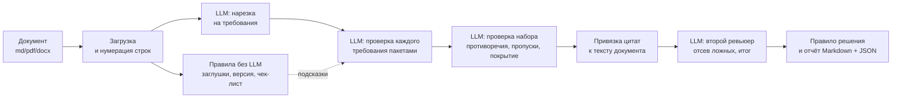

# RequirementLab — агент проверки требований

[](https://github.com/ikooq/requirementlab/actions/workflows/tests.yml)

AI-агент для **BCC-HUB × MNU FinTech Hackathon 2026** ([кейс](https://github.com/BCC-HUB/ai-requirements-validator-task)).
Агент проводит статическое ревью документа требований до начала разработки: нарезает документ на отдельные требования,
проверяет каждое требование и весь набор по ISO/IEC/IEEE 29148:2018 (п. 5.2.5, 5.2.6) и IEEE Std 830-1998 (п. 4.3)
и пишет отчёт на русском языке. Каждое замечание привязано к дословной цитате и номеру строки документа.

## Результат на документе кейса

**[Отчёт агента → `reports/report.md`](reports/report.md)** ([кратко на один экран](reports/report-brief.md)): 27 требований, 40 нарушений, из них 4 критичных. Итог: разработку и тестирование начинать нельзя. Найдены ключевые противоречия кейса: Ф-3 и Ф-4 (лимит push), AC-2 и Ф-2 (месяц покупки), цель «в момент покупки» и учёт только проведённых покупок, суммы в тиынах и порог в тенге, «сохранение» и «чтение» в описании метода, сохранение через GET, ответ 200 с `ERROR` вместо 400.

**[Тот же документ в PDF → `reports/report-pdf.md`](reports/report-pdf.md)**: та же версия v1.3.0, вход — `requirements.pdf` (148 строк с восстановленными таблицами). 34 требования, 54 нарушения, из них 3 критичных, итог — «нет»; все 91 цитата подтверждены по тексту PDF. Модели: `gemini-3.5-flash`, последний вызов — запасная `gemini-3.8-flash` (квота). С эталоном не сверялся: номера строк PDF отличаются от Markdown.

> **Происхождение цифр.** Сдаваемая версия агента — тег [**`v1.3.0`**](https://github.com/ikooq/requirementlab/tree/v1.3.0): она сформировала отчёт, и все цифры ниже относятся к ней (`gemini-3.5-flash`, 2 прохода). Текущий код (v1.3.2) на той же модели и в том же режиме нашёл **29 из 41** и 5 из 6 критичных ([отчёт](reports/final-v1.3.2.md)), то есть хуже, поэтому сдаётся v1.3.0. На запасной `gemini-3.5-flash-lite` в один проход текущий код нашёл 17 из 41. Качество сильно зависит от модели: проверяйте строку «Модель» в паспорте отчёта. Подробности — в [«Выбор отчёта для подачи»](docs/quality.md#выбор-отчёта-для-подачи).

| Что | Цифра | Как проверить |
| :--- | :--- | :--- |
| Полнота на кейсе | **37 из 41** дефектов эталона, **все 6 критичных** | [эталон](eval/golden.json): G01–G35 собраны до прогонов, G36–G41 — подтверждённые находки агента |
| Полнота на незнакомом документе | **22 из 30 (73%)**, все 5 критичных | [слепое ТЗ](docs/blind/autopay.md), эталон закоммичен до первого прогона — [подробно](docs/quality.md#слепая-проверка) |
| Точность | 38 из 40 на кейсе (2 повтора), 32 из 38 на слепом документе | на кейсе 38 меток выставлены автоматически по эталону — [подробно](docs/quality.md#точность) |
| Привязка к тексту | 70 из 70 цитат найдены в документе | `python -m eval.evidence docs/requirements.md reports/report.json` |

Что отличает агента: цитату ищет в документе сам агент, а не модель, и находка без найденной цитаты в отчёт не попадает. Решение «можно ли начинать» принимает правило (есть критичное нарушение — «нет»), модель его ослабить не может. Второй ревьюер снимает ложные срабатывания и дубли.

## Быстрый старт

Нужен Python 3.10 или новее. Если вместо Python открывается Microsoft Store, запускайте через `py`.

```bash
git clone https://github.com/ikooq/requirementlab && cd requirementlab
python -m pip install -r requirements.txt
cp .env.example .env          # Windows: copy .env.example .env — впишите GEMINI_API_KEY
curl -L --create-dirs -o docs/requirements.md https://raw.githubusercontent.com/BCC-HUB/ai-requirements-validator-task/928c1aa364265426105b69ba7a3444eac11b22db/docs/requirements.md
```

**Прогон одной командой** — путь к документу и путь к отчёту:

```bash
python run.py docs/requirements.md reports/report.md --brief
```

Отчёт ляжет в `reports/report.md`, короткая версия — в `reports/report-brief.md`, данные — в `reports/report.json`. На входе `.md`, `.txt`, `.pdf` (с текстовым слоем) и `.docx`.

Чтобы повторить анализ сдаваемой версией, сначала выполните `git checkout v1.3.0`, затем `python run.py docs/requirements.md reports/replay.md --passes 2 --batch-size 6 --no-cache` (флага `--brief` в этой версии нет).

**Проверка сдаваемого отчёта без ключа и без модели:**

```bash
python -m eval.evidence docs/requirements.md reports/report.json
python -m eval.promotion gate reports/report.json eval/promotion-review.csv
python -m reqlab.reader docs/requirements.md reports/report.json reports/review.html   # офлайн-просмотр: находка → строка документа
```

Тесты: `python -m pip install pytest && python -m pytest -q`.

## Ключ LLM и модели

1. Откройте [aistudio.google.com/apikey](https://aistudio.google.com/apikey), нажмите **Create API key** и скопируйте ключ. Ключ бесплатный.
2. Впишите его в `.env` в корне проекта: `GEMINI_API_KEY=...`. Файл `.env` исключён из Git, в репозитории только `.env.example`.

По умолчанию — `gemini-3.5-flash`, температура 0. Полный прогон в два прохода — около 20 запросов и 15 минут, а у бесплатного тарифа 20 запросов на модель в сутки на проект. Поэтому добавьте запасные ключи `GEMINI_API_KEY_2`, `GEMINI_API_KEY_3`…, **каждый из нового проекта** (Create API key → Create project): агент переходит на следующий ключ с той же моделью и только потом на запасные модели. Запасная модель видна на первом экране отчёта. С одним ключом запускайте `--passes 1`: около 11 запросов, полнота ниже.

Другая модель — `--model NAME` или `GEMINI_MODEL` в `.env`; подойдёт и любой OpenAI-совместимый API (`--provider openai`, примеры в `.env.example`). Остальные флаги: `python run.py --help`.

## Как работает агент



Проверка требований и набора выполняется дважды независимо, находки объединяются: один проход ловит около 80% дефектов эталона, но каждый раз немного разные. Критерии: по отдельному требованию — необходимость, уместность, однозначность, полнота, единичность, осуществимость, проверяемость, корректность, соответствие шаблону (ISO 29148 п. 5.2.5), трассируемость (IEEE 830 п. 4.3.8); по набору — полнота, непротиворечивость, осуществимость, понятность, валидируемость (ISO 29148 п. 5.2.6), ранжирование, модифицируемость, трассируемость (IEEE 830 п. 4.3).

**Отчёт:** паспорт прогона (документ и SHA-256, дата, модель, версия агента, параметры) → нарезка «ID в отчёте — ID в документе — формулировка — цитата» → матрица «требование × критерий» и замечания с цитатой, рекомендацией и вопросом владельцу → проверка набора → сводка и список критичных дефектов → итог «можно ли начинать» и что исправить первым → отсеянные находки с причиной.

```
run.py        точка входа          reqlab/   агент: loader, rules, llm, prompts, pipeline, grounding, report
eval/         эталоны и оценка     tests/    тесты без сети      docs/    слепые ТЗ и подробности
reports/      сдаваемый отчёт, слепые проверки; reports/experiments/ — альтернативные прогоны
```

## Ограничения

- Выводы модели вероятностны и зависят от модели: отчёт — помощник аналитика, а не замена ревью. Документ уходит выбранному LLM-провайдеру; для конфиденциальных документов используйте локальный OpenAI-совместимый сервер.
- PDF-сканы без текстового слоя не поддерживаются. Таблицы PDF без рамок читаются как текст, объединённые ячейки упрощаются.
- Эталоны составлены командой; независимой проверки человеком пока нет. Архив для внешнего ревьюера собирается в CI.

Подробности: [качество, слепые проверки, точность, эксперименты и порог CI](docs/quality.md) · [сценарий демо](docs/demo.md).
