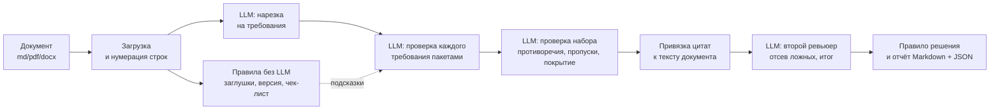

# RequirementLab — агент проверки требований

[](https://github.com/ikooq/requirementlab/actions/workflows/tests.yml)

AI-агент для **BCC-HUB × MNU FinTech Hackathon 2026** ([кейс](https://github.com/BCC-HUB/ai-requirements-validator-task)).
Агент проводит статическое ревью документа требований до начала разработки. Он нарезает документ на отдельные требования,
проверяет каждое требование и весь набор по ISO/IEC/IEEE 29148:2018 (п. 5.2.5, 5.2.6) и IEEE Std 830-1998 (п. 4.3),
а затем пишет отчёт на русском языке. Каждое замечание привязано к дословной цитате и номеру строки документа.

## Результат на документе кейса

**[Отчёт агента → `reports/report.md`](reports/report.md)**: 27 требований, 40 нарушений, из них 4 критичных. Итог: разработку и тестирование начинать нельзя. Найдены все ключевые противоречия кейса: Ф-3 и Ф-4 (лимит push), критерий приёмки AC-2 и Ф-2 (месяц покупки), цель «в момент покупки» и учёт только проведённых покупок, суммы в тиынах и порог в тенге, «сохранение» и «чтение» в описании метода, сохранение через GET, ответ 200 с `ERROR` вместо 400.

| Что | Как это обеспечено |
| :--- | :--- |
| Качество измерено, а не заявлено | Эталон из 41 дефекта кейса ([`eval/`](eval/)): отчёт находит **37 из 41 (90%)** и **все 6 критичных**. По 35 дефектам, собранным до прогонов, — 31 (89%); один проход проверки давал 80% |
| Проверено вслепую на втором документе | Новое ТЗ ([`docs/blind/autopay.md`](docs/blind/autopay.md)) с 30 заложенными дефектами, эталон закоммичен до первого прогона: **22 из 30 (73%)** по скрипту, 24 из 30 (80%) по ручной сверке, **все 5 критичных** — см. [«Слепая проверка»](#слепая-проверка) |
| Нет общих фраз без привязки к тексту | Агент сам находит каждую цитату в документе и вычисляет строку; находки без найденной цитаты отбрасываются |
| Итог нельзя «уговорить» | Решение «можно ли начинать» принимает правило: есть критичное нарушение — «нет». Модель не может его ослабить |
| Меньше ложных срабатываний | Второй ревьюер перепроверяет каждое «не определено» по всему документу и снимает дубли |
| Любой формат входа | MD, TXT, PDF и DOCX; таблицы PDF и DOCX восстанавливаются целиком, включая пустые ячейки |
| Прогон не срывается на бесплатном тарифе | Несколько ключей и запасные модели; перегрузку сервера агент пережидает, а не бросает модель |

## Быстрый старт

Нужен Python 3.10 или новее.

```bash
git clone https://github.com/ikooq/requirementlab && cd requirementlab
python -m pip install -r requirements.txt
cp .env.example .env          # Windows: copy .env.example .env
# впишите GEMINI_API_KEY в .env
```

Документ кейса скачивается из репозитория организаторов:

```bash
curl -L --create-dirs -o docs/requirements.md https://raw.githubusercontent.com/BCC-HUB/ai-requirements-validator-task/main/docs/requirements.md
```

На Windows `curl.exe` работает так же. Если вместо Python открывается Microsoft Store, запускайте через `py` вместо `python`.

**Прогон одной командой**: первый аргумент — путь к документу, второй — путь к отчёту.

```bash
python run.py docs/requirements.md reports/report.md
```

Отчёт ляжет в `reports/report.md`, а рядом в `reports/report.json` — те же данные в структурированном виде.
На входе поддерживаются `.md`, `.txt`, `.pdf` (с текстовым слоем) и `.docx`.

## Как получить ключ LLM

По умолчанию агент работает на **Google Gemini `gemini-3.5-flash`** (стабильная, не preview-версия), температура 0. Бесплатного тарифа хватает. Если исчерпана дневная квота (429) или модель снята (404), агент сам переключается на запасные: `gemini-3.7-flash`, `gemini-3.8-flash` и далее. Кратковременную перегрузку сервера (503) агент пережидает с нарастающей паузой и меняет модель только после 6 неудач подряд (около 2,5 минуты), чтобы весь отчёт по возможности делала одна модель. Модели, реально использованные в прогоне, записываются в паспорт отчёта.

**Воспроизводимость.** Структура отчёта, привязка цитат и правило итогового решения детерминированы. Формулировки находок и точное число требований при повторном прогоне могут немного отличаться: это свойство LLM, особенно если агент переключился на запасную модель. Чтобы получить ровно тот же отчёт, повторите прогон на той же модели; ответы модели кэшируются в `.cache/llm`.

1. Откройте [aistudio.google.com/apikey](https://aistudio.google.com/apikey) и войдите через Google-аккаунт.
2. Нажмите **Create API key** и скопируйте ключ.
3. Вставьте его в файл `.env` в корне проекта: `GEMINI_API_KEY=...`

Ключ хранится только в `.env`, а этот файл исключён из Git. В репозитории лежит только `.env.example` без ключа.

Можно указать запасные ключи `GEMINI_API_KEY_2`, `GEMINI_API_KEY_3` и так далее: когда у ключа кончается дневная квота, агент сразу переходит на следующий ключ с той же моделью и только потом — на запасные модели. Квота бесплатного тарифа считается на проект Google, поэтому запасной ключ должен быть создан в другом проекте (в AI Studio: **Create API key → Create project**).

Другая модель задаётся в `.env` (`GEMINI_MODEL=...`) или флагом `--model`. Можно взять и любой OpenAI-совместимый
API (OpenAI, Groq, OpenRouter, локальная Ollama): примеры есть в `.env.example`.

```bash
python run.py docs/requirements.md reports/report.md --provider openai --model gpt-4o-mini
```

| Флаг | Назначение |
| :--- | :--- |
| `--provider gemini\|openai` | провайдер LLM (по умолчанию — по ключу в `.env`) |
| `--model NAME` | модель |
| `--batch-size N` | сколько требований проверять за один запрос (по умолчанию 6) |
| `--passes N` | сколько независимых проходов проверки делать, находки объединяются (по умолчанию 2; `--passes 1` — вдвое меньше запросов) |
| `--brief` | дополнительно записать короткий отчёт на один экран рядом с полным (`report-brief.md`): итог, 7 главных дефектов, счёт по критериям, что исправить |
| `--no-verify` | пропустить шаг второго ревьюера |
| `--no-cache` | не брать ответы модели из кэша `.cache/llm` |
| `--quiet` | не печатать ход прогона |

## Как работает агент



| Шаг | Что происходит | Почему так |
| :--- | :--- | :--- |
| Загрузка | Текст разбивается на строки с номерами. У PDF сохраняется номер страницы, таблицы PDF и DOCX восстанавливаются строками «\| ячейка \| ячейка \|», включая пустые ячейки | Модель ссылается на строку, и ссылку можно проверить |
| Правила | Регулярные выражения находят заглушки («—», «заполняются»), незаполненный чек-лист, пустую таблицу согласующих, отсутствие версии, размытые слова | Дёшево, воспроизводимо, без галлюцинаций |
| Нарезка | Модель выделяет атомарные требования, критерии приёмки и служебные блоки. Нумерованные пункты документа (`Ф-1`…) дополнительно ищутся регулярным выражением, чтобы ни один не потерялся | Нужна таблица «ID в отчёте — ID в документе — формулировка» |
| Проверка требований | Пакеты по 6 требований, у модели весь документ как контекст. По каждому из 10 критериев ставится вердикт, у каждого нарушения есть цитата, рекомендация и вопрос владельцу | Пакеты экономят квоту бесплатного тарифа, полный контекст позволяет ловить противоречия |
| Проверка набора | Противоречия между частями A и B и критериями приёмки, пропущенные сценарии, покрытие критериями приёмки, единицы измерения | Пункт 5.2.6 ISO 29148 и пункт 4.3 IEEE 830 касаются набора, а не отдельной строки |
| Привязка цитат | Агент сам ищет каждую цитату в документе: с нормализацией кавычек, разметки и пробелов, затем нечётким поиском. Строку тоже вычисляет сам. Находки без найденной цитаты отбрасываются | В отчёте нет общих фраз без привязки к тексту |
| Два прохода | Проверка требований и набора выполняется дважды независимо: во втором проходе требования сгруппированы в пакеты иначе, и модель проверяет их заново. Находки объединяются | Один проход ловит около 80% дефектов эталона, но каждый раз немного разные; два прохода на кейсе дали 89% по исходным 35 дефектам и все критичные |
| Второй ревьюер | Отдельный проход модели убирает ложные срабатывания и дубликаты (в том числе между проходами), корректирует серьёзность и формулирует итог и приоритеты исправлений | Точность важнее количества |
| Решение | Есть критичное нарушение — «разработку начинать нельзя». Модель не может ослабить это правило | Итог детерминирован и объясним |

Полный прогон в два прохода — около 20 запросов к модели (около 15 минут с паузой 13 с между запросами под минутный лимит), в один проход (`--passes 1`) — около 11. У бесплатного тарифа Gemini есть дневной лимит: 20 запросов на модель в сутки. Поэтому для прогона в два прохода лучше указать запасной ключ из другого проекта (`GEMINI_API_KEY_2`); иначе агент доделает прогон на запасной модели и укажет это в паспорте. Ответы кэшируются в `.cache/llm`, поэтому повторный прогон того же
документа бесплатен. Временные ошибки (429/5xx) повторяются с паузой.

**Экономный режим.** Если ключ один и квота на исходе, запускайте с `--passes 1`: около 11 запросов вместо 20, в пределах дневного лимита одной модели. Цена — полнота: на эталоне кейса один проход находит около 80% дефектов, два — 89% (по 35 дефектам, собранным до прогонов). Критичные противоречия один проход тоже находит, но отдельные существенные дефекты от прогона к прогону выпадают.

### Критерии

| Уровень | Критерии | Источник |
| :--- | :--- | :--- |
| Отдельное требование | необходимость, уместность (нет лишних проектных решений), однозначность, полнота, единичность, осуществимость, проверяемость, корректность, соответствие шаблону | ISO/IEC/IEEE 29148 п. 5.2.5 |
| Отдельное требование | трассируемость | IEEE 830 п. 4.3.8 |
| Набор | полнота, непротиворечивость, осуществимость, понятность, валидируемость | ISO/IEC/IEEE 29148 п. 5.2.6 |
| Набор | ранжирование по важности, модифицируемость, трассируемость | IEEE 830 п. 4.3.5, 4.3.7, 4.3.8 |

Серьёзность нарушений: **критично** — блокирует разработку или тестирование, **существенно** — исправить до старта,
**незначительно** — стиль.

## Состав отчёта

1. **Паспорт прогона**: документ и его SHA-256, дата, модель, версия агента (git-коммит), число вызовов модели.
2. **Нарезка**: таблица «ID в отчёте — ID в документе — раздел — строки — краткая формулировка — цитата».
3. **Проверка каждого требования**: матрица «требование × критерий» и замечания с цитатой, местом, рекомендацией и вопросом.
4. **Проверка набора**: оценка по 8 критериям, межтребовательные замечания и автоматические проверки оформления.
5. **Сводка**: число требований и нарушений по серьёзности и критериям, список критичных дефектов (непроверяемые, противоречивые, неполные).
6. **Итог**: можно ли начинать разработку и тестирование и что исправить в первую очередь.
7. **Приложение**: отсеянные находки и причина отсева.

Полный отчёт длинный, потому что ТЗ требует матрицу по каждому требованию. Для первого знакомства есть короткая версия: флаг `--brief` пишет `report-brief.md` на один экран, номера находок в ней совпадают с полным отчётом.

## Структура репозитория

```
run.py              точка входа: python run.py <документ> <отчёт>
reqlab/
  loader.py         чтение md/txt/pdf/docx, нумерация строк
  rules.py          детерминированные проверки
  llm.py            клиенты Gemini и OpenAI-совместимого API: повторы, кэш, пауза
  prompts.py        промпты шагов
  pipeline.py       конвейер агента и правило решения
  grounding.py      поиск цитат в документе
  report.py         сборка отчёта
  criteria.py       критерии ISO 29148 и IEEE 830
tests/              тесты без сети (модель подменяется)
eval/               эталон дефектов кейса и скрипт оценки отчёта
reports/            отчёты прогонов
```

Тесты: `python -m pip install pytest && python -m pytest -q`

## Оценка качества по эталону

В `eval/golden.json` собран 41 дефект документа кейса со строками и серьёзностью: G01–G35 составлены вручную до прогонов агента, G36–G41 добавлены после того, как находки агента вне эталона были проверены по документу и подтвердились. Скрипт сверяет с ними отчёт агента: сколько дефектов найдено (с весами 3/2/1 по серьёзности), совпала ли серьёзность и какие находки в эталон не попали.

```bash
python eval/score.py reports/report.json -v            # один отчёт и находки вне эталона
python eval/score.py old/report.json reports/report.json # сравнить два прогона
python eval/score.py reports/report.json --min-recall 0.8 # код 1, если полнота ниже порога
```

Находка засчитывается за дефект, если её цитата стоит на строке дефекта (допуск ±1) и описание проблемы содержит его ключевые слова. Находка вне эталона — это либо ложное срабатывание, либо дефект, который стоит добавить в эталон.

### Слепая проверка

Чтобы проверить, что агент не подогнан под документ кейса, мы написали второе ТЗ — автоплатёж за мобильную связь ([`docs/blind/autopay.md`](docs/blind/autopay.md)) — и заложили в него 30 дефектов: 5 критичных противоречий, 19 существенных, 6 незначительных. Эталон [`eval/golden_autopay.json`](eval/golden_autopay.json) закоммичен вместе с документом в коммите `85ec081`, до первого прогона агента; после прогона ни эталон, ни промпты под этот документ не менялись.

```bash
python eval/score.py reports/blind/autopay.json --golden eval/golden_autopay.json -v
```

| Показатель | Слепой документ (1 проход) | Кейс (2 прохода) |
| :--- | ---: | ---: |
| Найдено дефектов эталона | **22 из 30 (73%)** | 31 из 35 (89%) |
| Взвешенная полнота | 77% | 91% |
| Найдено критичных | **5 из 5** | 6 из 6 |
| Серьёзность совпала | 19 из 22 | 25 из 31 |
| Находок вне эталона | 10 из 38 | 6 из 40 |

Что важно знать о цифре:

- **Это один проход.** Второй проход упёрся в дневную квоту основной модели, а запасная (`gemini-3-flash-preview`) трижды вернула один и тот же некорректный JSON. Отчёт [`reports/blind/autopay.md`](reports/blind/autopay.md) собран из первого прохода на `gemini-3.5-flash`, второй ревьюер работал на `gemini-3.7-flash`; это записано в паспорте. На кейсе один проход давал около 80%, так что 73% — сопоставимый уровень, а не провал на незнакомом тексте.
- **Скрипт строгий.** Пустые Prod URL и Swagger агент нашёл (находка F-033, строки 105 и 107), но правило описало их общей фразой без имени поля, и ключевые слова не совпали. С ними — 24 из 30 (80%). Эталон мы не правили; правило теперь называет поле.
- **Пропущено:** канал и текст уведомления о неуспешном платеже (B11), карта в другой валюте (B12), время и часовой пояс списания (B14), критерии приёмки не покрывают Ф-2–Ф-5 (B17), кнопка «Подключить» против «Сохранить» (B25), цель «номер не блокируется» против отказа от повторов (B30).
- **Вне эталона** из 10 находок 5 — настоящие дефекты, которые мы не заложили: нет идемпотентности создания (F-032), не описано поведение для чужой карты (F-023), не описан сторно при сбое зачисления (F-030), неполная модель данных (F-019), расчёт nextDate для 29–31 чисел (F-026). Остальные 5 — придирки к оформлению (нет идентификаторов у разделов, составной шаг логики) и дубль правила.

Вывод: на незнакомом документе агент находит все критичные противоречия и около трёх четвертей всех дефектов. 89% на кейсе — оценка сверху, потому что промпты дорабатывались на его пропусках.

## Ограничения

- Выводы модели вероятностны: при другой модели или температуре формулировки находок могут отличаться. Отчёт — помощник аналитика, а не замена ревью.
- PDF-сканы без текстового слоя не поддерживаются (нужен OCR).
- Таблицы PDF распознаются по линиям сетки (PyMuPDF); таблица без рамок читается как обычный текст. Если PyMuPDF не установлен, PDF читается через pypdf без восстановления таблиц.
- Объединённые ячейки таблиц DOCX и PDF упрощаются.
